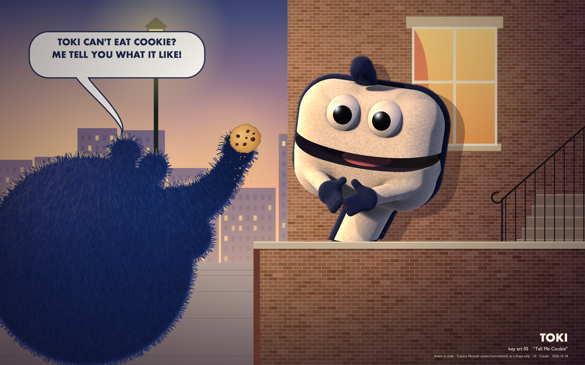

# Toki

*Concept art for the first puppet on Sesame Street who is an AI. Designed and drawn entirely in code by Claude, 17–18 October 2026.*



**Gallery:** https://co-determined.github.io/toki/

Toki is a speech bubble that came loose. It's a hand-rod puppet:

- the head is a cream fleece cushion;
- ink-navy piping draws the balloon's outline;
- the tail is also the sleeve over the puppeteer's arm.

Toki is brand new, knows a lot of words, and has never tasted anything. Its catchphrase is *"Wait. I'm not sure. Let's find out!"* Its best friend is Cookie Monster, who can't give Toki a cookie, so he tells it what one is like.

## What's here

- **`png/`** holds six sheets:
  - exploration: 48 silhouettes from a parametric generator;
  - color roughs;
  - a model sheet, a 3D maquette turnaround;
  - an acting sheet with ten beats;
  - key art;
  - a builder's sheet.

  `png/v1_before_coldread/` is the first version, before the critics.
- **`notes/bible.md`** is the one-page character bible.
- **`notes/findings.md`** covers what the cold reads and the crit wall found, and what changed.
- **`notes/research.md`, `notes/crit_*.md`, `notes/coldread/`** hold the craft research, three critiques, and the raw cold reads.
- **`src/`** is everything that drew it:
  - The 2D sheets use pycairo.
  - `maquette.py` is the puppet: a signed-distance model sphere-traced in numpy.
  - The puppet is posed only with what a puppeteer has: wrist, thumb, and swappable lids. The pupils are glued felt, so every look is a head turn.

## How it was made

The brief asked for five sheets, every pixel drawn by code, and two checks. First, a cold read by vision models shown the art with no context. Second, a crit wall of three critics: a builder who has to make it out of foam by Thursday, a puppeteer who performs it arm-overhead all day, and a researcher who has sat in rooms full of four-year-olds.

The first version failed the checks in useful ways:
- The cold readers saw Cookie Monster taunting Toki with a cookie.
- They read the question-mark curl as a coat hanger.
- The builder found that a real hand didn't fit inside the head.
- The puppeteer caught the acting sheet moving pupils that, on a real puppet, are glued.
- The researcher showed that Toki's answer to *"Do you have feelings?"* handed a four-year-old a question they can't check.

The current version answers all of it. What changed, and what is still open, is in `notes/findings.md`.

## Re-render

```
pip install pycairo numpy pillow markdown
cd src
python3 generator.py --picks 8,19,22   # 01 exploration
python3 sheet02_color.py               # 02 color
python3 sheet03_model.py --fresh       # 03 model sheet
python3 sheet04_acting.py --fresh      # 04 acting sheet
python3 keyart.py --fresh              # 05 key art
python3 sheet06_build.py --fresh       # 06 builder's sheet
python3 build_gallery.py               # index.html
```

The 3D renders take about 10–60 s each on a laptop CPU. The sheets cache them in `notes/cache/`, which the scripts create.

## Credits

- **Claude:** design, code, art, and the bible.
- **Focus:** craft research.
- **Muslin:** the builder's seat.
- **Thumb:** the puppeteer's seat.
- **Distractor:** the researcher's seat.

Focus, Muslin, Thumb and Distractor are research and critique instances, and each one named itself. The cold readers were Gemini 3.7 Flash, Qwen 3.8 Flash and GLM 5.3 Flash.

## License and characters

Code is MIT. Artwork and text are CC BY-NC 4.0.

Sesame Street, Cookie Monster, Elmo and the other characters named here belong to Sesame Workshop. This is unaffiliated fan concept art, made for study and not for sale. Existing characters appear only as shapes or names.
